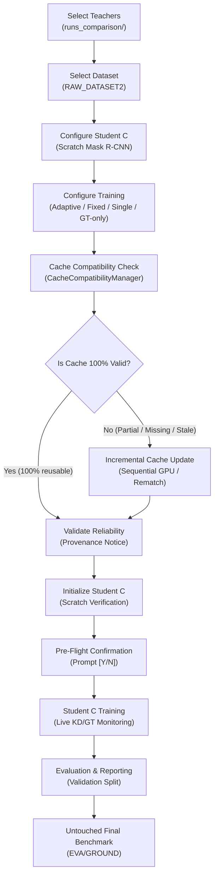

# Unified Interactive Adaptive Multi-Teacher Distillation Workflow Guide

This guide describes the unified, interactive, end-to-end training workflow for the **Ground-Truth-Guided Adaptive Multi-Teacher Distillation Pipeline** in `CAR_TRAIN1`.

---

## 1. Executive Overview

The workflow unifies teacher model selection from `runs_comparison/`, dataset selection, Student C scratch initialization, automated cache compatibility checking, incremental cache generation, reliability calibration, training, and evaluation into a **single, unified entry point**.



---

## 2. Launching the Workflow

### Method A: From the Master Root Orchestrator
Launch the project's interactive Python orchestrator:
```bash
python3 orchestrator.py
```
Select **Option 14**:
```text
  14) Adaptive Distillation  -- Unified interactive multi-teacher KD training pipeline
```

### Method B: Direct Interactive Workflow Entry Point
```bash
python3 pipelines/adaptive_distillation/run_training.py
```

### Method C: Non-Interactive Automation & CLI Flags
```bash
# Check cache compatibility and print report
python3 pipelines/adaptive_distillation/run_training.py --check_cache

# Incrementally prepare missing cache without launching training
python3 pipelines/adaptive_distillation/run_training.py --prepare_cache

# Run complete automated workflow with overrides
python3 pipelines/adaptive_distillation/run_training.py \
  --auto \
  --mode adaptive \
  --epochs 50 \
  --batch_size 2 \
  --exp_name e6_adaptive_multiteacher
```

---

## 3. The 10-Step Interactive Workflow

When running `pipelines/adaptive_distillation/run_training.py`, an interactive menu guides the user:

```text
===========================================================================
 GROUND-TRUTH-GUIDED ADAPTIVE MULTI-TEACHER DISTILLATION SYSTEM
===========================================================================
 Current Experiment: e6_adaptive_multiteacher | Mode: adaptive
 Teachers:           ['teacher_a_m2f', 'teacher_b_m2f']
 Dataset:            RAW_DATASET2 (32_class)
 Student:            maskrcnn (scratch)
---------------------------------------------------------------------------
  1)  Select Teachers                -- Choose teacher models from runs_comparison/
  2)  Select Dataset                 -- Select dataset, split, taxonomy & annotations
  3)  Configure Student C            -- Choose scratch student architecture
  4)  Configure Training             -- Set epochs, batch size, mode, lr, temp
  5)  Check Cache Compatibility      -- Validate existing cache against current config
  6)  Prepare Missing Cache          -- Incrementally build missing/changed predictions
  7)  Validate Teacher Reliability   -- View exploratory calibration scores & CI
  8)  Initialize Student C           -- Verify scratch initialization & parameters
  9)  Start Student C Training       -- Train student with offline cache guidance
  10) Evaluate on Validation Split   -- Evaluate checkpoints & generate markdown report
  A)  Run All End-to-End             -- Automated check -> prepare -> train -> evaluate
  0)  Exit
===========================================================================
```

### Step 1: Teacher Selection
- Automatically scans `runs_comparison/` for trained Mask2Former and YOLO checkpoints.
- Displays Run ID, architecture, weights path, validation mAP50, best epoch, class count, taxonomy, checkpoint SHA-256 hash prefix, and dataset compatibility status.
- Supports selecting single teachers (`1`), multi-teacher teams (`1,2`), all compatible teachers (`all`), or entering a custom path.

### Step 2: Dataset Selection
- Default: `RAW_DATASET2` (native 32-class car-parts taxonomy, 5,212 train, 652 calib, 652 val).
- Supports legacy `combined_carparts` (23 classes) or custom dataset roots.
- Verifies taxonomy compatibility to prevent silent class dropping.

### Step 3: Student C Configuration
- Prioritizes verified `maskrcnn` (Mask R-CNN ResNet-50-FPN v2, initialized strictly with `weights=None`).
- Verifies that zero pretrained weights are loaded into the student model.

### Step 4: Training Experiment Configuration
- Modes:
  - `adaptive`: Ground-truth-guided dynamic trust weighting ($w = g \cdot s \cdot \omega$).
  - `fixed`: Multi-teacher uniform 50/50 fusion.
  - `single`: Distillation from Teacher A only.
  - `gt_only`: Pure supervised baseline (lower anchor bound).
- Hyperparameters: Epochs, batch size, learning rate, optimizer (`adamw` / `sgd`), temperature $\tau$, workers, and random seed.

### Step 5: Automatic Cache Compatibility Check
- `CacheCompatibilityManager` inspects the manifest, checkpoint hashes, dataset hashes, and cache index.
- Outputs the formatted ASCII report showing exact counts of valid, missing, changed, or corrupted records.

### Step 6: Intelligent Incremental Cache Generation
- **Zero re-inference for valid records:** Existing predictions are reused.
- **Annotation-only changes:** If images are unchanged but annotations were edited, the pipeline recomputes Hungarian matching and trust weights from cached predictions without running GPU teacher inference.
- **Incremental append:** Generates predictions only for missing/changed images and appends new numbered shards (`shard_XXXXX.npz`), updating the index atomically.
- **GPU isolation:** Loads teachers sequentially onto the GPU (one at a time) and unloads them before training.

### Step 7: Teacher Reliability Calibration & Scientific Provenance
- Evaluates teacher precision, recall, and TP IoU on `calib_652.json`.
- Displays the **Selection Bias Notice** (clarifying that calibration images were partitioned from the original validation pool).
- Enforces the **Asymmetry Rule**: GT matches can veto unreliable predictions ($\omega = 0.0$), but cannot artificially boost trust above the calibration ceiling.

### Step 8: Initialize Student C
- Instantiates Student C and verifies that 100% of parameter tensors have `requires_grad=True` and random initial weights.

### Step 9: Student C Training & Live Monitoring
- Displays a comprehensive pre-flight summary and asks for confirmation (`Start training? [Y/N]`).
- Zero teacher weights reside in GPU VRAM during training (streamed batch-by-batch from disk).
- Progress bar and epoch summary log:
  - GT loss ($L_{\text{GT}}$)
  - KD loss ($L_{\text{KD}}$)
  - Loss ratio: $R_{\text{KD/GT}} = \frac{\lambda(t) L_{\text{KD}}}{L_{\text{GT}} + \epsilon}$ (stabilized at $0.42 - 0.46$)
  - Effective mass: $\bar{\omega}$
  - Current learning rate and GPU VRAM usage.
- Automatically saves `last.pt` and `best.pt`. Supports resuming interrupted training.

### Step 10: Automatic Evaluation & Reporting
- Evaluates checkpoints on the validation split (`val_652.json`).
- Outputs mask & box mAP50, mAP50-95, and per-class AP tables.
- Preserves `EVA/GROUND` (110 images) strictly untouched for final benchmark verification.

---

## 4. Cache Compatibility Decision Table

| Situation | Detection Mechanism | Action Taken | Compute Cost |
|---|---|---|---|
| **All records valid** | Manifest & index match dataset | Reuse existing cache | 0.0s (0 inference) |
| **New images added** | Dataset image IDs not in index | Generate cache for new images only | $O(N_{\text{new}})$ |
| **Image content changed** | Image file hash differs from record | Regenerate predictions for changed images | $O(N_{\text{changed}})$ |
| **Annotation changed, image unchanged** | JSON annotation hash differs | Rematch GT & recompute $\omega$ from cache | $\sim 1\text{s}$ CPU (0 GPU) |
| **Teacher checkpoint changed** | Checkpoint SHA-256 differs | Regenerate predictions for that teacher only | $O(N_{\text{total}})$ single teacher |
| **Preprocessing changed** | `imgsz` or `mask_scale` differs | Regenerate affected predictions | $O(N_{\text{total}})$ |
| **Taxonomy changed** | Class count / names differ | Remap if safe, else regenerate | $O(N_{\text{total}})$ |
| **Cache corrupted** | Shard missing or unreadable | Rebuild affected records | $O(N_{\text{corrupted}})$ |
| **Cache missing entirely** | Directory or manifest empty | Generate full required cache | Full Phase A |

---

## 5. Resuming Interrupted Training

If training is interrupted, simply launch Option 9 or rerun:
```bash
python3 pipelines/adaptive_distillation/run_training.py
```
When `last.pt` is detected in the experiment directory, the system will prompt:
```text
Found existing checkpoint at .../last.pt. Resume training? [Y/N] (default: N):
```
Selecting `Y` restores the model weights, optimizer state, best validation mAP, and resumes from the exact interrupted epoch.

